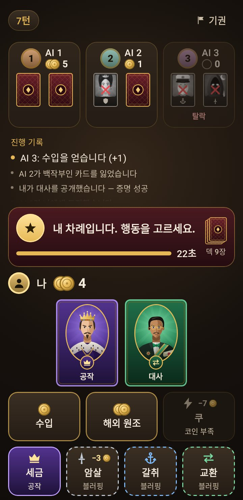
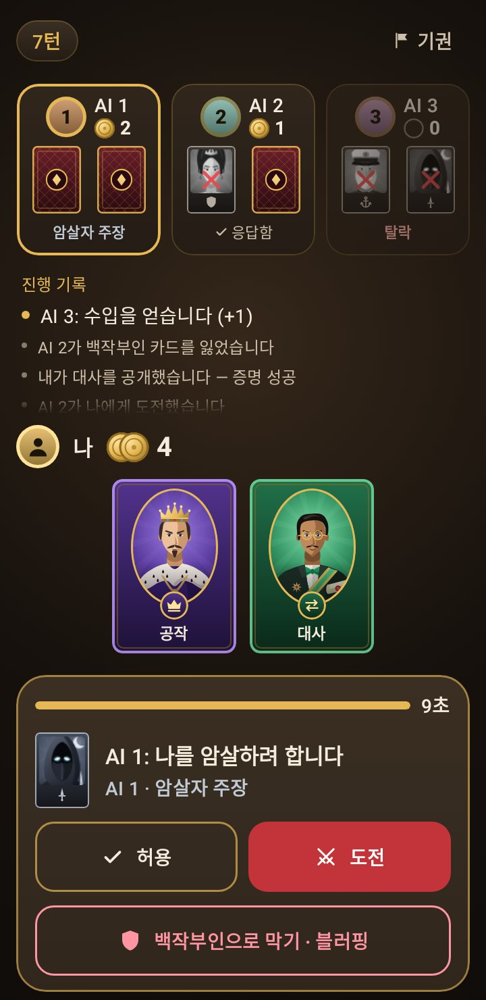
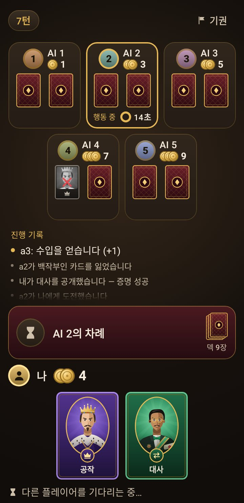
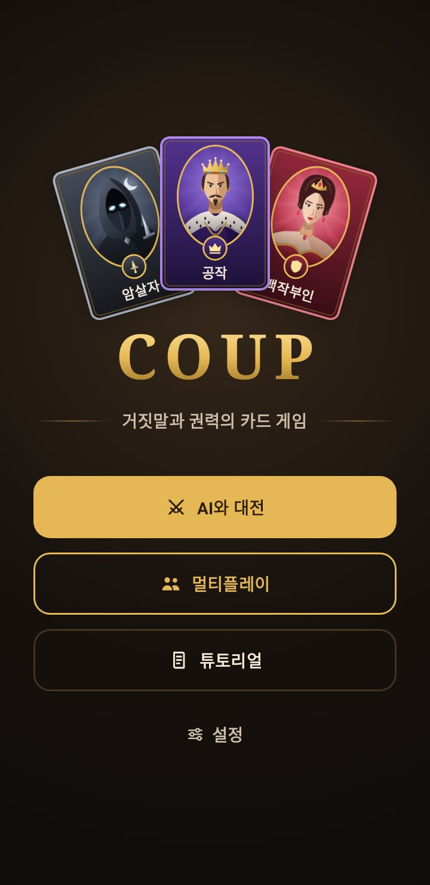

# 화면 디자인

백로그 1번("가독성·시인성이 나쁘고 게임 같지 않다")으로 정한 앱의 모습과, 그 모습을 만드는 부품·규칙을 적는다.
화면을 고칠 때는 이 문서의 규칙을 지키고, 고친 뒤에는 [스크린샷 모음](#스크린샷-모음)으로 눈으로 확인한다.

| 내 차례 | 응답할 차례 | 6인 판 | 홈 |
|---|---|---|---|
|  |  |  |  |

## 방향: 촛불 아래의 테이블

- **한 가지 모습.** 어두운 호두나무 테이블, 가운데의 촛불빛, 황동·금 장식, 양피지 글씨. 기기의 밝은/어두운 설정을 따르지 않는다(밝은 테마와 다이내믹 컬러를 없앴다) — 카드·역할 색의 대비를 한 가지 바탕에 맞춘다.
- **테이블에 앉은 순서대로 놓는다.** 위에서 아래로: 표시줄(턴·규칙·기권) -> 건너편의 상대들 -> 기록 -> 가운데 무대(지금 벌어지는 일) -> 내 카드 -> 내가 누를 것.
  무대·내 카드·결정은 항상 보이게 아래에 고정하고, 상대·기록만 스크롤한다.
- **가장 중요한 것이 가장 크다.** 내 카드가 화면에서 가장 큰 그림이고, 그다음이 지금 벌어지는 일과 내가 누를 것이다. 기록은 작게 둔다.
- **역할마다 색과 문양이 있다.** 공작 보라·왕관, 암살자 강철빛·단검, 사령관 파랑·닻, 대사 초록·맞바꿈, 백작부인 붉은색·방패.
  카드, 행동 칸, 막기 버튼, 주장 표시가 모두 같은 색·문양을 쓴다 — 한 번 익히면 어디서나 읽힌다.
- **진실과 블러핑이 모양으로 갈린다.** 내가 든 역할의 행동·막기는 그 역할 색으로 **채우고**, 블러핑은 **점선 테두리만** 그린다(글자 "블러핑"도 함께).

## 색과 글꼴 (`ui/theme`)

- `Color.kt`: 테이블(`TableEdge`/`TableBase`/`TableGlow`), 패널(`PanelLow`..`PanelTop`), 무대의 펠트(`FeltHigh`/`FeltLow`), 금(`Gold`/`GoldBright`/`GoldDeep`), 글씨(`Parchment`/`ParchmentDim`), 붉은색(`Crimson`…), 자리 색(`SeatTints`).
  글씨 두 색은 패널 위에서 대비 7:1 이상이다. 자리(아바타) 색은 역할 색과 헷갈리지 않게 채도가 낮은 흙빛이다.
- `Type.kt`: 제목은 세리프(기기의 명조 계열), 본문·버튼은 고딕. 글꼴 파일을 넣지 않았다.
- `Theme.kt`: Material 3 색 역할을 위 팔레트로 채운다(대화상자·카드·버튼이 따로 손대지 않아도 같은 모습이 된다). 상태 표시줄 아이콘은 밝게.

## 부품 (`ui/kit`)

| 부품 | 하는 일 |
|---|---|
| `TableSurface` | 모든 화면의 바탕. 액티비티가 창 전체(시스템 바 아래까지)에 한 번 그리고, 안쪽 화면은 다시 그리지 않는다. 화면마다 `Surface(color = background)` 대신 쓴다 |
| `Modifier.panel()` / `felt()` | 테이블 위의 판(금색 실선 테두리) / 가운데 무대의 붉은 펠트 |
| `Modifier.fadingEdges(scroll)` | 스크롤 영역의 잘리는 가장자리를 흐리게 한다(글자가 반쯤 잘려 보이지 않게). `verticalScroll` **앞에** 붙인다 |
| `PlayingCardFace` / `PlayingCardBack` | 카드. 너비에 비례해 그려서 자리의 작은 카드(36dp)부터 확대 창(228dp)까지 같은 그림이다. 52dp보다 좁으면 얼굴 + 문양만, 넓으면 타원 초상 + 문양 + 이름. `lost`(빛바램 + X), `selected`(금색 테두리) |
| `RoleVisuals` | 역할 ID -> 색·문양·초상. 모르는 역할은 금빛 중립 카드(문양만) |
| `CoupIcons` | 직접 그린 24x24 벡터 문양(왕관, 단검, 닻, 방패, 번개, 칼 …). 글꼴·그림 파일이 없다 |
| `CoinIcon` / `CoinPile` | 코인. 더미는 많을수록 겹쳐 보인다(3개부터 두 닢, 7개부터 세 닢) |
| `Avatar` | 플레이어 표식. 이름이 숫자로 끝나면 그 숫자, 아니면 첫 글자 |
| `PrimaryButton` / `SecondaryButton` | 채운 버튼(시작·확정·도전·막기) / 테두리 버튼(허용·취소). 높이 52dp |

### 카드 초상

역할 다섯의 초상은 **이 저장소에서 그린 그림**이다. `tools/card-art/portraits.py`가 도형(경로·그라데이션)으로 그려 Android 벡터 드로어블
(`res/drawable/portrait_*.xml`, 장당 9~15KB)로 내보낸다. 사진이나 남의 그림을 쓰지 않아 출처 문제가 없고, 어느 크기에서도 선명하다.

| 공작 | 암살자 | 사령관 | 대사 | 백작부인 |
|---|---|---|---|---|
| 왕관, 흰 담비 털 깃, 금 사슬 | 두건, 어둠 속에서 빛나는 눈, 복면, 단검, 초승달 | 제모와 닻 휘장, 흰 수염, 금 견장 | 금테 안경, 나비넥타이, 장식 띠와 별 훈장, 두루마리 | 올림머리, 작은 왕관, 귀걸이, 붉은 드레스 |

- 그림판은 300x400(3:4)이고 카드는 그 안의 타원만 보인다. 자리의 작은 카드는 가운데(머리)를 당겨 보이므로 **머리와 모자는 x 60~240, y 60~260 안에** 둔다.
- 빛은 왼쪽 위에서 온다(얼굴 오른쪽이 그늘). 바탕은 역할 색이고 머리 뒤에서 엷은 빛살이 퍼진다.
- 고칠 때는 스크립트의 숫자를 고치고 다시 돌린다. **XML을 직접 고치지 않는다**(다음에 돌리면 덮어쓴다).

```
python3 tools/card-art/portraits.py                  # res/drawable/portrait_*.xml 을 다시 쓴다
python3 tools/card-art/portraits.py --preview DIR    # 확인용 SVG 와 preview.html 도 DIR 에 쓴다(브라우저로 연다)
```

옛 카드 PNG 6장(장당 2~3MB)은 글자가 그림에 박혀 있어 작으면 읽히지 않고 영어에서도 한국어로 보였으며, 그 초상(사진풍)은 출처를 확인할 수 없었다 —
모두 지웠다(git 기록에는 남아 있다). 이름·능력은 글자로 그린다. `CardArtTest`가 초상이 벡터 그림인지 지킨다.

## 게임 화면 (`game/`)

| 파일 | 담당 |
|---|---|
| `GameScreen.kt` | 화면 뼈대(좁은 화면 1단 / 840dp 이상 2단), 대화상자(결과·기권·버려진 판), 연결 배너, 튜토리얼 안내 |
| `GameTable.kt` | 표시줄, 상대 자리, 가운데 무대, 기록 |
| `GameHand.kt` | 내 자리·손패, 카드 확대 |
| `GameDecision.kt` | 행동 칸, 대상 고르기, 카드 확정, 응답 시트 |
| `GameFx.kt` | 연출(뒤집기·코인·맥박·시트 등장), 남은 시간(링/막대) |
| `Josa.kt` | 한국어 조사 고르기("AI 2이(가)" -> "AI 2가", "나이(가)" -> "내가") |

- **상대 자리**: 옆으로 밀지 않아도 모두 보이게 줄을 나눈다(1~3명 한 줄, 4명 2x2, 5명 3+2; 화면이 좁으면 줄을 늘린다). 지금 움직이는 사람은 금색 테두리가 맥박친다.
  대상을 고르는 중에는 고를 수 있는 **자리를 눌러서** 고를 수 있다(이름 버튼도 그대로 있다).
- **가운데 무대**: 왼쪽 문장(紋章)이 상황을 한눈에 알린다(내 차례 = 별, 역할 주장 = 그 역할, 도전 = 칼, 막기 = 방패, 영향력 잃음 = X). 내 결정의 남은 시간은 막대로 붙는다.
- **응답할 차례**: 응답 시트 하나에 상황·남은 시간·버튼이 모인다(가운데 무대는 그동안 접힌다). 허용은 테두리만, 도전은 붉은색, 막기는 역할 색.
- **기록**: 가장 최근 일이 맨 위에 크게 나온다 — 아래가 잘려도 방금 일어난 일은 보인다.
- **낮은 화면**(620dp 미만): 내 카드를 줄이고, 무대의 덱 그림을 표시줄의 글자로 옮긴다.

## 지켜야 할 것

1. **색만으로 전하지 않는다.** 블러핑·필수·잠긴 이유·선택됨·공개됨·탈락은 글자로도 나온다. 잃은 카드는 X가 붙는다.
2. **누르는 영역은 48dp 이상.** 자리의 작은 카드(36dp)도 누르는 상자는 48dp다.
3. **연출은 `LocalMotion`을 따른다.** 꺼져 있으면(설정 "끄기", 기기의 애니메이션 없음) 즉시 끝난 모습이어야 한다. 상태는 연출과 상관없이 이미 바뀌어 있다.
4. **계속 도는 연출은 그리는 단계에서만 값을 읽는다**(`drawWithContent`, `graphicsLayer { }` 안). 구성 단계에서 읽으면 매 프레임 화면을 다시 구성한다.
5. **카드 안의 글자는 그림이다.** 카드 크기에 맞춰 그리고 접근성 트리에 내지 않는다 — 이름은 부르는 쪽이 `semantics`로 알린다.
6. **테스트 태그(`GameTags`…)와 스크린리더 설명은 약속이다.** 모습을 바꿔도 태그·설명("코인 N", "덱 N장", 카드 이름)은 남긴다.
7. **작은 화면(320x568dp)과 큰 글씨(1.6배)에서 눌러야 하는 것이 스크롤 없이 보여야 한다** — `GameScreenTest`가 그 조건으로 끝까지 둔다.

## 스크린샷 모음

기기 없이 실제 렌더링으로 주요 화면의 PNG를 만든다(`ScreenshotGalleryTest`, Robolectric 네이티브 그래픽). 평소 테스트에서는 건너뛴다.

```
./gradlew :app:testDebugUnitTest --tests '*ScreenshotGalleryTest*' -Pscreenshots=          # app/build/screenshots/
./gradlew :app:testDebugUnitTest --tests '*ScreenshotGalleryTest*' -Pscreenshots=/어떤/폴더
```

새 화면이나 상태를 만들면 여기에 한 장 더한다. 글꼴은 기기와 다를 수 있다(이 환경에는 한글 명조가 없어 한글 제목이 고딕으로 나온다 — 기기에서는 명조로 보인다).

## 아직 하지 않은 것

- **실기기 확인이 필요한 것**: 한글 세리프 제목의 실제 모습(기기 글꼴), 맥박·무대 전환 연출의 체감, 시스템 바 아래 배경, 큰 화면(태블릿) 2단 배치의 균형.
- **멀티플레이 화면**(로그인·로비·방 만들기·대기실·랭킹·전적): 같은 바탕·색·글꼴을 입었지만 배치는 그대로다. 게임 화면만큼의 손질은 하지 않았다.
- **극적인 순간의 큰 연출**(도전 성공/실패, 탈락, 승리의 전체 화면 연출), 코인이 자리 사이를 날아가는 연출, 햅틱.
